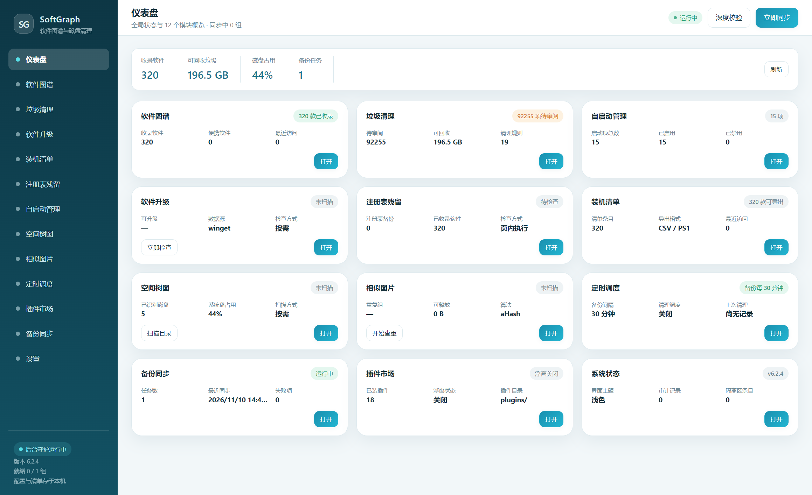
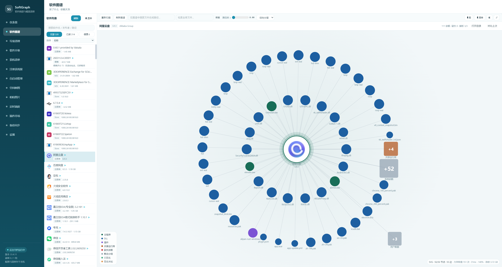
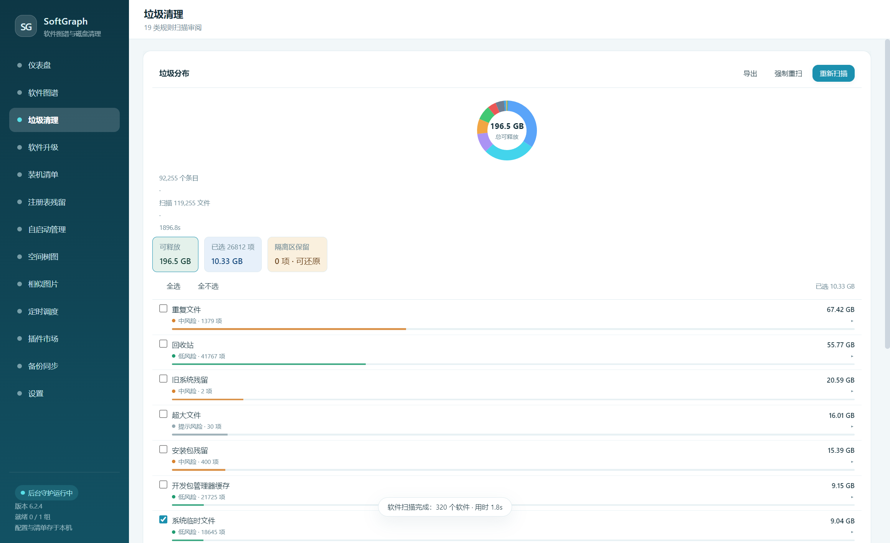
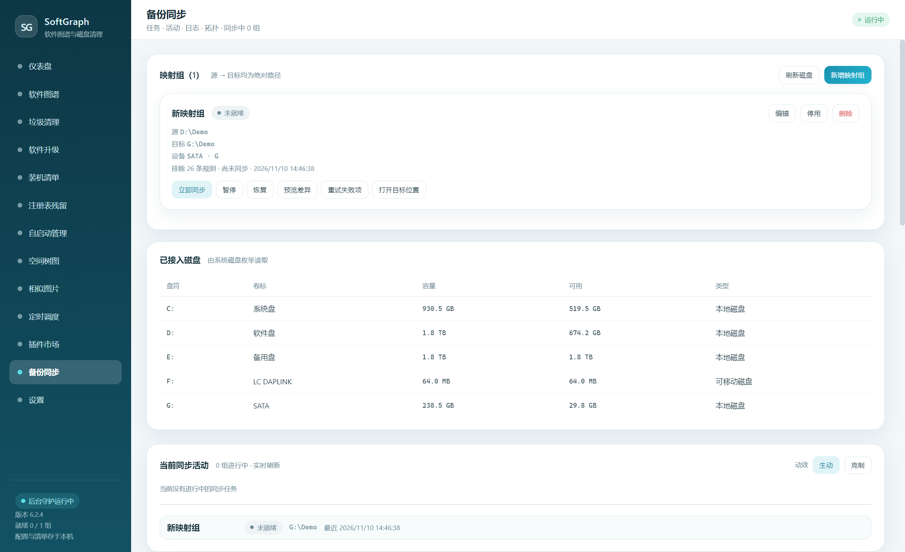

# SoftGraph — 软件图谱与磁盘清理工具

一款 Windows 桌面应用：把「装了什么 / 依赖谁 / 垃圾在哪 / 重要资料备份到哪」四件事合并成一个工作台。

- **软件总仪表盘**：启动即看全局——磁盘占用、垃圾总量、软件收录、备份健康，12 个模块卡直达各功能区；侧栏 13 项平铺导航，无分组层级。
- **软件图谱**：以软件图标为中心，直线连接外围依赖文件，鼠标悬停即显示完整路径与全部属性；支持按分类删除与一键清空。
- **备份同步**：目录映射差异预览 → 确认 → 执行（只增改不删），30 分钟自动同步，传输过程四阶段动效演出，来源/目标拓扑可视化。
- **桌面浮窗**：常驻桌面的透明浮窗，内容由插件自由组合，支持靠边自动隐藏、鼠标移入滑出。

依据《SoftGraph 软件图谱与磁盘清理工具 技术设计方案 V1.0》实现，技术路线为
**Electron 33 + Vue 3 + TypeScript + Vite + d3-force + SQLite**。

---

## 快速开始

### 直接运行（推荐）

到 [Releases](https://github.com/xiaowulai-s/Soft_Graph/releases/latest) 下载（当前 v6.2.5），或用仓库根目录构建：

```bash
npm install                 # 已内置 npmmirror 镜像配置（.npmrc）
npm run dev                 # 开发模式（热重载）
npm run build               # 构建到 out/
npm run pack:win            # 产出 release/<版本>/ 下的安装包 + 便携版
```

打包产物（以 v6.2.4 为例）：

| 文件 | 说明 |
|---|---|
| `SoftGraph Setup 6.2.5.exe` | NSIS 安装包（约 90 MB），可选安装目录、创建快捷方式 |
| `SoftGraph-6.2.5-portable.exe` | 免安装便携版（约 90 MB），双击即用 |
| `latest.yml` + `.blockmap` | electron-updater 自动更新元数据 |

> 未做代码签名（正式证书待接入，见 [`docs/07-代码签名.md`](docs/07-代码签名.md)），
> 杀软可能误报（扫描类工具常见，对应设计文档风险 R8），加入白名单即可；
> 发布前用 `npm run sign:check` 确认签名状态与产物验收结论。

### 首次使用

1. 启动即见**软件总仪表盘**：收软件 320 / 可回收垃圾 196.5 GB / 磁盘占用 / 备份任务数，12 个模块卡点击直达
2. 左侧「软件图谱」→ 选任一软件 → 自动构建依赖图谱；鼠标移到节点显示完整路径等七项详情
3. 「垃圾清理」→ 开始扫描 → 按分类勾选 →「分类删除」或「一键删除」（默认进隔离区可还原）
4. 「备份同步」→ 新增映射组（目录对 + 目标盘）→ 预览差异 → 确认同步（只增改不删）→ 可开启 30 分钟自动同步

---

## 功能一览

### 模块一：软件图谱工具

| 能力 | 说明 |
|---|---|
| 软件发现 | 注册表卸载项（HKLM/HKCU + WOW6432Node）、MSI 产品、App Paths、Microsoft Store、服务宿主 |
| 便携软件识别 | 七特征加权：目录自包含 +30 / 无卸载项 +20 / 本地配置 +15 / 目录可写 +10 / 无安装器痕迹 +10 / 版本资源 +10 / 手动标记 +100 |
| 依赖解析 | 纯 TS PE 解析器：导入表、延迟导入表、.NET 程序集引用、SxS 清单、版本资源 |
| 证据融合 | 八类证据（E1–E7 已实现，E8 预留）加权出 0~1 置信度，含共享惩罚 |
| Windows 特殊机制 | API Set 映射、KnownDLLs、WinSxS 重定向、WOW64 位数感知的 DLL 搜索顺序 |
| 缺失依赖预警 | 红色虚线节点 + 修复建议（如提示安装 VC++ 运行库） |
| 图谱可视化 | 径向分层（T0–T3）、SVG/Canvas 双渲染、缩放平移惯性、搜索筛选、双击下钻、右键菜单、导出 PNG |
| 悬停详情 | 标题 / 完整路径（可复制）/ 属性 / 关系 / 归属 / 安全 / 操作 —— 七区块齐全 |
| 垃圾治理 | 18 类规则（GC-01~GC-18，含 AI 工具缓存 / AI IDE 缓存族 / 浏览器隐私 / 空目录；分区模型 builtin⊕community⊕user）JSON 驱动 + Ed25519 签名在线更新、重复文件三级过滤、环形图 + 分类列表 + 明细抽屉 |
| 删除安全 | 白名单硬拦截 + 三重校验 + 隔离区可还原 + 三级确认强度 |
| 自启动管理 | 注册表 Run/RunOnce 四键 + 启动文件夹双源枚举；签名状态色点、目标缺失标记；可逆启停（AutorunsDisabled 兼容），HKLM 走 UAC |
| 磁盘空间树图 | Squarified Treemap 交互式可视化：目录下钻、面包屑、文件块送回收站/打开位置 |
| 一键启动 | 软件列表 ▶ 直启 + 图谱右键启动（shell.openPath）；全局热键 Alt+G 聚焦搜索（可关） |
| 装机清单 | 一键导出 CSV（名称/版本/发布者/路径）或 PS1（winget 批量静默安装脚本）——换机重装闭环 |

### 模块二：桌面浮窗监控

| 能力 | 说明 |
|---|---|
| 悬浮窗口 | 无边框 / 透明 / 置顶 / 不占任务栏 / 不抢焦点 / 可见于全屏工作区 |
| 靠边自动隐藏 | 贴边判定 + 3px 触发条 + 鼠标移入缓动滑出 + 延迟收起 |
| 内容自定义 | 插件勾选与排序、宽度、透明度、紧凑模式、三套主题（深色/浅色/毛玻璃） |
| 插件化架构 | `plugins\*.js` 动态加载、热重载、单插件错误隔离；内置 7 个插件；**插件市场**（官方索引 Gitee 直连 + GitHub 回退，可自定义索引 URL；安装/更新/权限预览） |
| 内置插件 | CPU 与内存、磁盘空间、网络速率、时钟日期、垃圾占用、系统概览、内存 TOP 进程 |
| 官方市场插件 | 时钟（无权限）、磁盘治理概览（无权限）、升级脉搏（winget 查询，需授权）、硬件脉搏（CIM 查 CPU/内存/系统盘，需授权 PowerShell） |

### 模块三：备份同步

| 能力 | 说明 |
|---|---|
| 差异预览 | 映射任务先扫描来源↔目标差异（新增 / 更新 / 目标多出 / 已一致四类），确认后才执行，**只增改不删** |
| 任务管理 | 多映射任务（目录对 + 盘符绑定卷标校验），排除目录支持通配（内置 26 条构建产物排除项，跳过 .asar 伪目录） |
| 自动同步 | 可调间隔（最小 15 分钟），调度器每 15 分钟检查；目标盘离线自动跳过；与手动任务互斥 |
| 过程可视化 | 扫描 / 预览 / 传输 / 完成四阶段动效（vivid / calm 两档，可切换；页面隐藏或掉帧自动降档）；rAF 实测 60fps |
| 失败韧性 | 损坏目录整树跳过、单文件失败可重试、错误全量可观测、日志可复制 |
| 数据安全 | 数据目录互斥锁防多实例互踩；退出前全量落盘（设置 / 数据库 / 日志跑完才退） |

---

## 界面

| 软件总仪表盘（启动首页） | 软件图谱 + 依赖详情 |
|---|---|
|  |  |

| 垃圾清理（扫描完成态） | 备份同步（任务与拓扑） |
|---|---|
|  |  |

---

## 实测数据（本机 Windows 11）

| 项目 | 结果 |
|---|---|
| 软件收录 | **320 个**（已装 314 / 便携 6），枚举 19~28s |
| 依赖解析 | Siemens NX 2506（11.75GB 目录）→ **6027 个依赖**，17s |
| 图谱渲染 | 阿里云盘 → 111 依赖，径向布局秒级收敛；BaiduNetdisk → 634 节点 / 633 边 |
| 垃圾扫描 | 全量 18 类 → **196.5 GB / 92,255 项**（2026-11 实测，含重复文件与缓存类） |
| 备份同步 | 预览差异（61 新增 / 89 更新 / 24 万已一致）→ 确认 → 写入，传输动效 rAF 实测 60fps |
| 安全校验 | 扫描结果中受保护路径条目数 **0** |

详见 [`docs/04-验证报告.md`](docs/04-验证报告.md)。

---

## 文档

| 文档 | 内容 |
|---|---|
| [`docs/01-需求实现对照.md`](docs/01-需求实现对照.md) | FR-01~FR-16 与非功能指标逐条对照、已知差距 |
| [`docs/02-架构与实现.md`](docs/02-架构与实现.md) | 分层架构、目录结构、关键算法、与设计方案的实现差异 |
| [`docs/03-插件开发.md`](docs/03-插件开发.md) | 浮窗插件契约、五种视图、ctx 能力、示例 |
| [`docs/04-验证报告.md`](docs/04-验证报告.md) | 内核冒烟 + 真机端到端数据、缺陷修复记录 |
| [`docs/05-推送与发布.md`](docs/05-推送与发布.md) | 推送远端、Release 资产发布与历次发布记录、离线 bundle 搬运 |
| [`docs/06-v2.0.0-开发计划.md`](docs/06-v2.0.0-开发计划.md) | v2.0.0 规划：遗留问题清单、7 条工作主线、里程碑与验收标准、M0 交付明细 |
| [`docs/07-代码签名.md`](docs/07-代码签名.md) | 证书选择、electron-builder 接线、`npm run sign:check` 预检与产物验收、杀软白名单申报 |
| [`docs/08-v3.0.0-开发计划.md`](docs/08-v3.0.0-开发计划.md) | v3.0.0 规划：v2 遗留清单收编、里程碑排期、**未完成清单（含已实测排除项）**、验收清单与验证记录 |
| [`docs/09-顺延项补全计划（A2-A3-A7-I11）.md`](docs/09-顺延项补全计划（A2-A3-A7-I11）.md) | 四项性能/工程化顺延项的实测结论（含 A7 原方案被数据推翻的经过） |
| [`docs/benchmarks/`](docs/benchmarks/) | 性能基准与覆盖率报告（每次 `npm run bench` / `test:cov` 生成）；[`compat-matrix.md`](docs/benchmarks/compat-matrix.md) 是 Win10/Win11 兼容矩阵（由 `npm run compat:probe` 产出数据） |
| [`Update.md`](Update.md) | 版本变更记录与排期 |

---

## 数据位置

| 内容 | 路径 |
|---|---|
| 数据库 / 设置 | `%LOCALAPPDATA%\SoftGraph\data\softgraph.db`、`settings.json` |
| 实例互斥锁 | `%LOCALAPPDATA%\SoftGraph\data.lock`（同数据目录仅允许一个实例；调试并行时用 `SG_DATA_DIR` 指向独立目录） |
| 图标缓存 | `%LOCALAPPDATA%\SoftGraph\cache\icons\` |
| 隔离区 | `%LOCALAPPDATA%\SoftGraph\Quarantine\<批次>\manifest.json` |
| 垃圾规则 | 分区模型：内置规则随应用打包（不落盘）⊕ `%LOCALAPPDATA%\SoftGraph\rules\community-rules.json`（Winapp2 导入与在线更新）⊕ `user-rules.json`（用户自定义，永不覆盖） |
| 浮窗插件 | `%LOCALAPPDATA%\SoftGraph\plugins\` |
| 导出报告 | `%LOCALAPPDATA%\SoftGraph\reports\` |

卸载时**不会**删除用户数据，隔离区内容保留可还原性。

---

## 安全设计

- **路径白名单硬编码**：`packages/shared/safety.ts` 以纯函数固化，不读配置文件，篡改设置无法绕过
  - System32 / SysWOW64 / WinSxS / Program Files 等整树禁删
  - 卷根目录、UNC 路径、关键系统文件（`pagefile.sys` 等）拦截
  - 用户桌面 / 文档 / 下载等目录本身不可删，其内部文件可清
- **删除三重校验**：白名单 → `realpath` 防 junction 逃逸 → 删除前复核 size + mtime 防路径复用
- **隔离区兜底**：默认移入隔离区（低中风险保留 7 天、高风险 14 天），可完整还原
- **一键删除边界**：仅作用于「低风险且默认勾选」的分类，中高风险必须单独确认，此规则不可通过设置关闭
- **零上传**：全部扫描、解析、统计在本地完成，不向任何服务端发送文件路径或软件清单

---

## 与设计文档的实现差异（Rust 原生层降级）

| 文档设计 | 本实现 | 影响 |
|---|---|---|
| Rust + napi-rs（PE / 图标 / USN / 回收站） | 纯 TS PE 解析器 + PowerShell System.Drawing | 无 USN 增量（FR-13 一期缺），其余等价 |
| API Set 从 PEB `ApiSetMap` 读取 | 静态前缀映射表 + 磁盘存在性校验 | 覆盖主要族群，未映射者标记为虚拟而非缺失 |
| better-sqlite3 + WAL | 双驱动：优先 `node:sqlite`，回退 sql.js（WASM） | FTS5 路径检索退化为 LIKE |
| Restart Manager 占用检测 | 移动失败按 `errno` 判定 + PowerShell 反查占用进程 | 少了「主动关闭进程」一步 |
| utilityProcess 扫描隔离 | 主进程执行，保留任务 ID / 流式分批 / 可取消契约 | 扫描时 IPC 响应略延迟，UI 不冻结 |
| `reg.exe` / `MsiEnumProducts` | PowerShell .NET Registry API + JSON 文件管道 | 规避控制台代码页乱码与安全策略拦截 |

完整说明见 [`docs/02-架构与实现.md`](docs/02-架构与实现.md)。

---

## 开发

```bash
npm run typecheck     # tsc + vue-tsc 双套类型检查
npm test              # 单元测试（esbuild + node:test，零新增依赖）
npm run bench         # 性能基准（完整，含 18 类全量垃圾扫描 + 500 条社区规则场景）
npm run bench:quick   # 性能基准（快速，跳过重量级规则）
npm run samples:collect  # 采集 PE 样本库清单（样本文件不入库，本机 707 个 / 5.2s）
npm run samples:verify   # 按清单回归校验解析器（漂移检测）
npm run test:cov         # 单元测试 + 行覆盖率（零依赖 sourcemap 还原到 TS 源）
npm run compat:probe     # 跨基线兼容探测：逐卷 USN / API Set / RM / 长路径…→ 兼容矩阵行
npm run sign:check       # 代码签名预检 + 产物签名验收（无证书时给出明确结论）
npm run pack:dir      # 仅产出未打包目录（调试用）
```

### 规则在线更新（GC 规则包，Ed25519 签名）

应用内置签名公钥，可在线接收新规则而无需重装。设置 → 清理与安全 → 规则更新源：

    https://raw.githubusercontent.com/xiaowulai-s/Soft_Graph/main/packages/rules/dist
    国内镜像: https://cdn.jsdelivr.net/gh/xiaowulai-s/Soft_Graph@main/packages/rules/dist

> 注：v3.0.2 起下载走 Electron net（系统代理可用）；v3.0.1 若 fetch failed，
> 多为直连被网络拦截，可改用镜像地址或挂代理后重试。

内核冒烟（不启动 GUI，直接跑扫描内核）：

```bash
npm run smoke
```

真机端到端（需先以 `--remote-debugging-port=9222` 启动应用）：

```bash
npm run e2e
```

代码规模：126 个源文件 / 约 10,700 行（TS + Vue，apps/desktop/src + packages）。CI 见 [`.github/workflows/ci.yml`](.github/workflows/ci.yml)。

---

## 许可证

[MIT](LICENSE)
